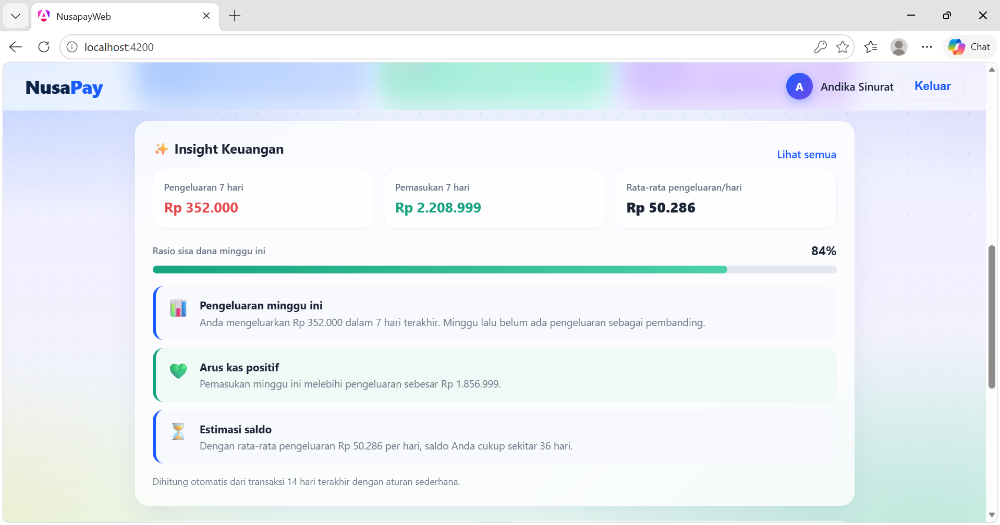
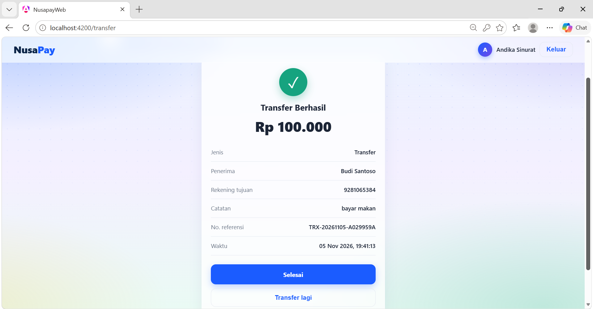
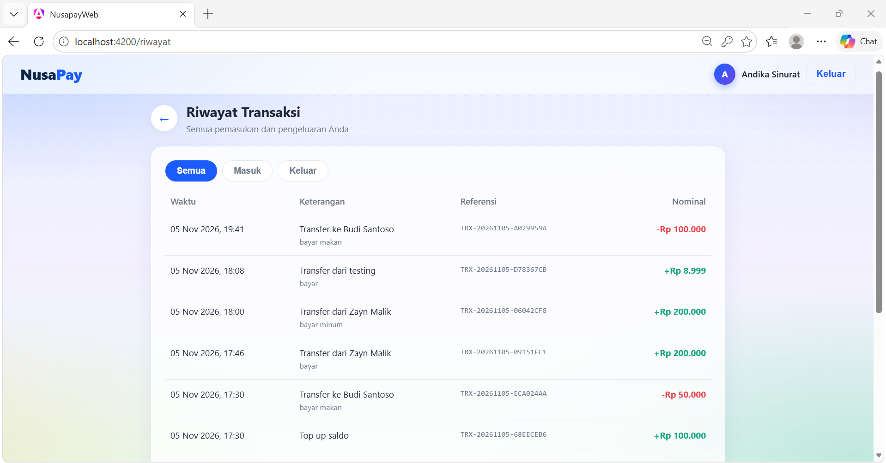

# NusaPay

Aplikasi dompet digital sederhana: daftar akun, top up (simulasi), transfer antar pengguna, riwayat transaksi, dan Insight Keuangan. Dibuat sebagai tugas seleksi magang developer di PT Visionet.

## Fitur
- Registrasi dan login dengan JWT. Dompet dengan nomor 10 digit dibuat otomatis saat registrasi, saldo awal Rp0.
- Top up saldo dengan struk. Ini **simulasi** (tanpa pembayaran sungguhan), dibatasi Rp2.000.000 per transaksi dan Rp5.000.000 per hari.
- Transfer antar dompet dengan konfirmasi dan struk.
- Penanganan kasus gagal: saldo tidak cukup, transfer ke rekening sendiri, rekening tidak ditemukan.
- Riwayat transaksi dengan tab Semua, Masuk, dan Keluar.
- Insight Keuangan di Beranda dan halaman `/insight` (analisis berbasis aturan).
- Tampilan responsif untuk HP dan desktop.

## Tampilan




*Transfer ditolak karena saldo tidak cukup; saldo tidak berubah.*

## Stack
Angular, ASP.NET Core Web API (.NET), MySQL/MariaDB, EF Core (Pomelo), JWT, BCrypt.

## Struktur
- `NusaPay.Api/`: backend (Controllers, Services, DTOs, Models, Migrations, Middleware)
- `nusapay-web/`: frontend Angular

## Menjalankan dari nol
Prasyarat: .NET SDK, Node.js, Angular CLI, MySQL atau MariaDB.

1. Buat database kosong:
   ```sql
   CREATE DATABASE nusapay;
   ```
2. Sesuaikan connection string di `NusaPay.Api/appsettings.json`. Nilai bawaan memakai konfigurasi lokal XAMPP (user `root`, tanpa password, port `3308`). Sesuaikan port, user, dan password dengan database Anda (umumnya port 3306).
3. Jalankan backend:
   ```bash
   cd NusaPay.Api
   dotnet ef database update
   dotnet run
   ```
   Swagger: http://localhost:5129/swagger
4. Jalankan frontend (terminal lain):
   ```bash
   cd nusapay-web
   npm install
   ng serve
   ```
   Buka http://localhost:4200

## Akun demo
Daftar akun baru lewat halaman Register. Untuk menguji transfer, daftarkan dua akun lalu top up salah satunya.

## Keputusan teknis
- **Transfer atomic**: satu transaksi database dengan `SELECT ... FOR UPDATE` yang mengunci baris dompet. Urutan kunci selalu berdasarkan Id sehingga tidak terjadi deadlock saat A→B dan B→A bersamaan. Saldo dicek setelah baris terkunci, jadi dua transfer bersamaan tidak bisa membuat saldo minus.
- **Idempotency key**: header `Idempotency-Key` mencegah transaksi ganda saat klik dua kali atau retry.
- **Check constraint di database**: saldo tidak boleh negatif (`CK_Wallets_Balance_NonNegative`) dan nominal transaksi harus positif (`CK_Transactions_Amount_Positive`), sebagai lapisan pengaman terakhir.
- **BCrypt**: password disimpan sebagai hash.
- **Penanganan error terpusat**: `ExceptionMiddleware` mengubah error menjadi respons JSON dengan status code yang tepat. Pesan login gagal sengaja disamakan agar tidak membocorkan email yang terdaftar.
- **User dan dompet dibuat dalam satu `SaveChanges`**, sehingga tidak mungkin ada user tanpa dompet.
- **Batas top up**: karena top up simulasi, ada batas per transaksi dan harian (hari dihitung WIB). Pengecekan dilakukan setelah dompet dikunci.

## Catatan keamanan
- `Jwt:Key` di `appsettings.json` adalah nilai demo. Untuk produksi, gunakan environment variable atau secret manager.
- Connection string memakai konfigurasi lokal XAMPP (root tanpa password) hanya untuk pengembangan.

## Rencana pengembangan
- Top up lewat payment gateway dengan verifikasi webhook (saat ini simulasi).
- PIN transaksi dan OTP.
- QRIS, pembelian pulsa, dan listrik.
- Integrasi model AI untuk Insight Keuangan (saat ini berbasis aturan).
- Unit test untuk `WalletService`.